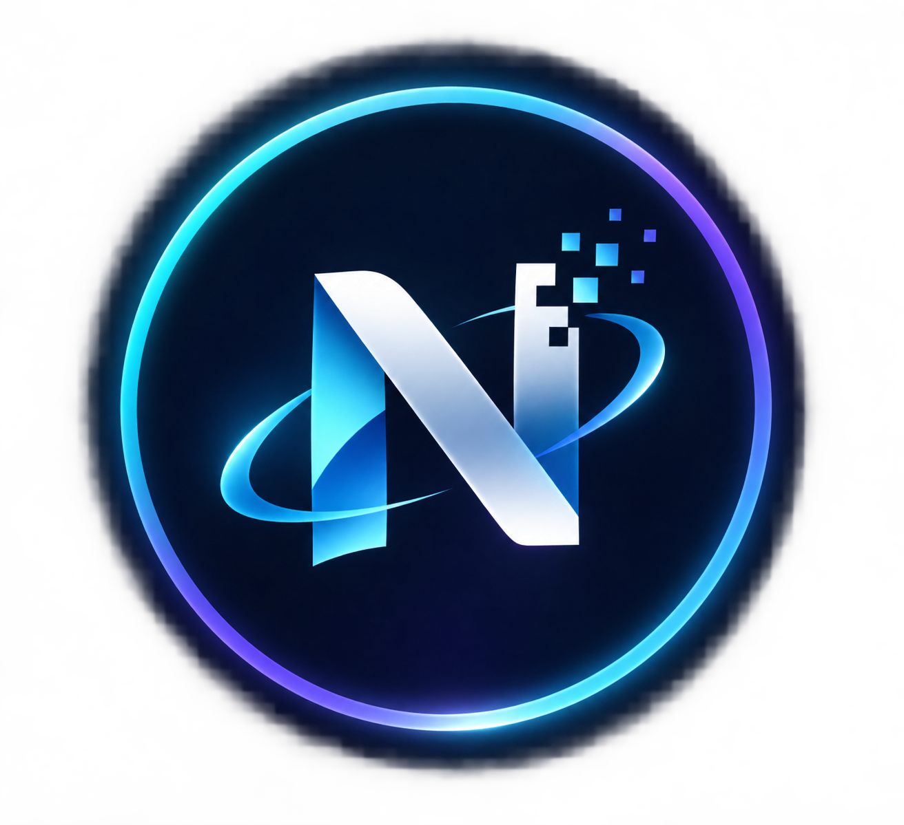
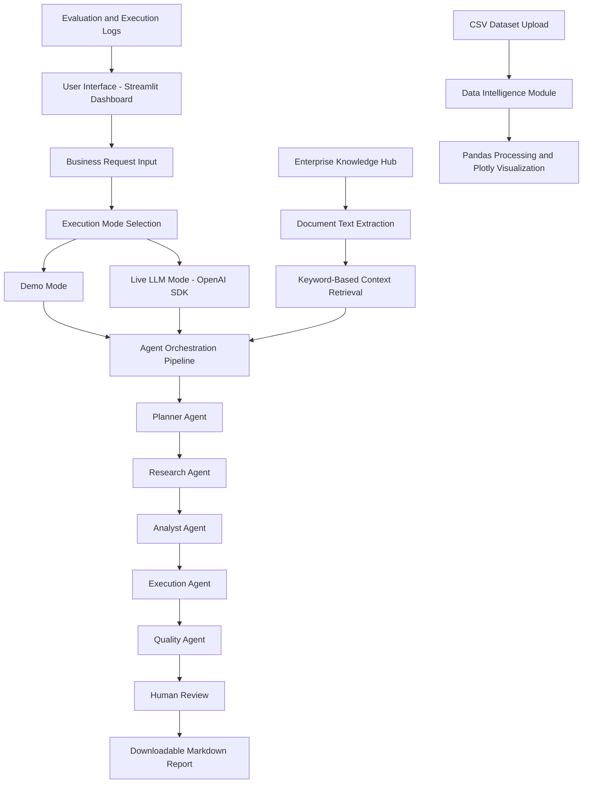
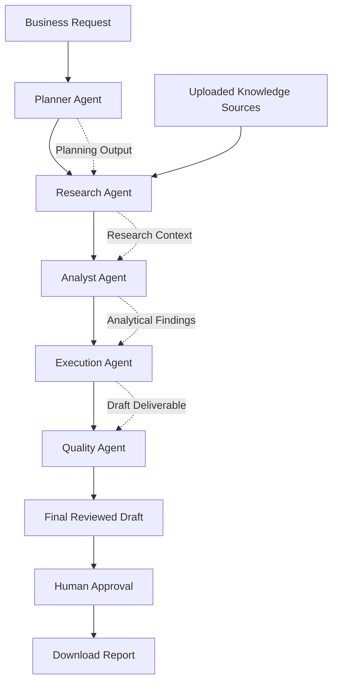

# NEXUS AI
### Enterprise Agentic AI Platform for Autonomous Workflow Automation & Intelligent Decision-Making

<p align="center">
  
</p>

<p align="center">
  <strong>Transforming Business Requests into Intelligent, Structured and Actionable Workflows</strong>
</p>

<p align="center">
  
  
  
  
  
</p>

<p align="center">
  <a href="YOUR_RENDER_PUBLIC_URL">Live Demo</a> •
  <a href="#system-architecture">Architecture</a> •
  <a href="#core-capabilities">Features</a> •
  <a href="#installation-and-setup">Installation</a> •
  <a href="#responsible-ai-and-security">Responsible AI</a>
</p>

---

## Overview

**NEXUS AI** is an enterprise-oriented Agentic AI platform designed to demonstrate how coordinated AI agents can support complex business workflows through task planning, knowledge retrieval, information analysis, structured content generation and quality evaluation.

Developed using Python and Streamlit, the platform implements a five-stage specialist-agent workflow in which individual agents perform different responsibilities and contribute to a shared execution pipeline.

Rather than relying on a single conversational AI interface, NEXUS AI organizes business requests into a structured sequence of intelligent processing stages:

- Planning and task decomposition.
- Research and contextual knowledge retrieval.
- Analytical reasoning and information synthesis.
- Deliverable generation.
- Quality assurance and human review.

The platform also incorporates document intelligence, CSV-based exploratory analytics, predefined enterprise workflow templates, downloadable reports and execution history.

NEXUS AI supports two execution modes:

- **Demo Mode:** Provides illustrative agent outputs without requiring an external API key.
- **Live LLM Mode:** Integrates an LLM through the OpenAI Python SDK to generate model-powered responses across the specialist-agent pipeline.

The project demonstrates the practical integration of Generative AI, multi-agent workflow patterns, enterprise knowledge assistance and interactive business intelligence within a unified application.

## Project Objectives

The primary objective of NEXUS AI is to demonstrate how AI-driven workflow systems can transform unstructured business requests into organized, reviewable and actionable deliverables.

Key objectives include:

1. Implementing a coordinated multi-agent architecture with clearly separated responsibilities.
2. Demonstrating sequential AI task orchestration.
3. Enabling contextual knowledge retrieval from uploaded enterprise documents.
4. Supporting document-based research and information analysis.
5. Providing exploratory data analysis through an interactive interface.
6. Automating the generation of structured business deliverables.
7. Introducing a dedicated quality-review stage.
8. Encouraging human oversight and responsible AI-assisted decision-making.

## Core Capabilities

### 1. Multi-Agent AI Orchestration

NEXUS AI implements five specialist agents, each assigned a distinct responsibility within the workflow.

| Agent | Responsibility |
|---|---|
| Planner Agent | Understands the request and organizes it into structured execution steps. |
| Research Agent | Retrieves relevant contextual information from uploaded knowledge sources. |
| Analyst Agent | Organizes evidence, identifies patterns, separates assumptions and develops analytical insights. |
| Execution Agent | Generates structured business deliverables based on the request and previous agent outputs. |
| Quality Agent | Reviews the generated output for completeness, consistency, assumptions and potential risks. |

The agents operate sequentially, with previous outputs incorporated into the context provided to subsequent stages.

This creates a structured multi-stage processing pipeline rather than an isolated single-prompt interaction.

### 2. Enterprise Knowledge Hub

The Knowledge Hub allows users to upload reference documents and make their contents available to the agent workflow.

**Supported formats:**

- PDF
- TXT
- Markdown
- CSV

**Capabilities:**

- Document ingestion and text extraction.
- Session-based document management.
- Lightweight keyword-based contextual retrieval.
- Relevant paragraph identification.
- Source-name association with retrieved content.
- Context preparation for downstream agent stages.
- Document preview within the dashboard.

The current implementation uses lightweight keyword matching to identify relevant document passages. It is designed as an introductory retrieval workflow and does not yet implement a persistent vector database or production-grade semantic retrieval.

### 3. Data Intelligence & Exploratory Analytics

The Data Intelligence workspace provides an interactive environment for examining uploaded CSV datasets.

**Dataset analysis capabilities:**

- Dataset preview and structural inspection.
- Row and column identification.
- Data-type analysis.
- Missing-value detection.
- Duplicate-record identification.
- Unique-value analysis.
- Numeric feature exploration.
- Descriptive statistical summaries.
- Interactive histogram visualizations.
- Box-plot distribution analysis.

The platform uses Pandas for data processing and Plotly for interactive visualizations.

### 4. Workflow Automation Lab

The Workflow Lab provides predefined workflow templates for common enterprise knowledge-work scenarios.

Available templates include:

| Workflow | Purpose |
|---|---|
| Customer Feedback Intelligence | Organizes feedback analysis, recurring issues and improvement recommendations. |
| Policy and Compliance Assistant | Supports document-based policy review and ambiguity identification. |
| Market Research Brief | Structures research objectives, competitor comparisons and evidence requirements. |
| Operations Incident Summary | Organizes incident information, timelines, potential impact and follow-up actions. |

These templates provide reusable workflow instructions that can be transferred into the Agent Workspace.

They are workflow planning templates rather than integrations that directly execute actions in external business systems.

### 5. AI-Powered Deliverable Generation

The Execution Agent converts the combined workflow context into structured draft outputs.

Examples include:

- Executive summaries.
- Business research briefs.
- Analytical findings.
- Operational recommendations.
- Improvement plans.
- Document-based responses.
- Structured action plans.

Generated outputs can be reviewed within the application and downloaded as Markdown reports.

### 6. Evaluation & Execution Logs

The Evaluation & Logs workspace provides visibility into workflow activity and responsible AI review.

**Implemented functionality:**

- Workflow execution history.
- Execution timestamps.
- Request summaries.
- Demo or Live execution-mode identification.
- Workflow completion status.
- Responsible AI review checklist.
- System limitation documentation.

The quality-review stage also examines generated outputs for completeness, consistency and the need for human verification.

The current execution history is maintained within the Streamlit session rather than a persistent audit database.

---

## Platform Architecture

NEXUS AI follows a modular, sequential multi-agent workflow architecture.

The application receives a business request, prepares relevant contextual information, passes the task through five specialist stages and produces a structured output for human review.

### High-Level System Architecture



### Multi-Agent Processing Architecture

The central orchestration pipeline consists of five sequential stages.



### Agent Responsibilities in Detail

**Stage 1 — Planning**

The Planner Agent receives the original business request and develops a structured execution plan.

Its purpose is to:

- Identify the primary objective.
- Organize the task into smaller stages.
- Establish the analytical direction.
- Prepare the execution context.

**Stage 2 — Research**

The Research Agent receives the task and available document context.

Its purpose is to:

- Examine relevant uploaded information.
- Retrieve contextual passages.
- Identify available supporting information.
- Highlight limitations when supporting evidence is unavailable.

**Stage 3 — Analysis**

The Analyst Agent examines the available information and develops a structured analytical interpretation.

Its purpose is to:

- Organize relevant findings.
- Separate factual information from assumptions.
- Identify possible patterns and risks.
- Prepare recommendations and analytical observations.

**Stage 4 — Execution**

The Execution Agent uses the request and preceding agent outputs to generate the requested deliverable.

Its purpose is to:

- Synthesize the available context.
- Produce structured content.
- Organize findings into actionable sections.
- Generate a downloadable report.

**Stage 5 — Quality Assurance**

The Quality Agent performs a final review of the generated content.

Its purpose is to:

- Examine completeness.
- Identify inconsistencies.
- Highlight unsupported assumptions.
- Review potential risks.
- Recommend human verification before consequential use.

---

## Technology Stack

| Technology | Application |
|---|---|
| Python | Core application development and workflow logic |
| Streamlit | Interactive dashboard and user interface |
| OpenAI Python SDK | Optional live LLM integration |
| Pandas | Data processing and exploratory analytics |
| Plotly | Interactive charts and data visualization |
| pypdf | PDF text extraction |
| Python Virtual Environment | Dependency isolation |
| Render | Public application deployment |
| Git & GitHub | Version control and source-code management |

### Technology Categories

**Artificial Intelligence**
- Generative AI.
- Large Language Models.
- Multi-agent workflow orchestration.
- Sequential agent execution.
- Context-aware generation.
- AI-assisted quality review.

**Knowledge Engineering**
- Document ingestion.
- Text extraction.
- Keyword-based retrieval.
- Context preparation.
- Source-associated information retrieval.

**Data Analytics**
- Exploratory Data Analysis.
- Data profiling.
- Missing-value analysis.
- Duplicate detection.
- Descriptive statistics.
- Interactive visualization.

**Application Engineering**
- Python application development.
- Streamlit dashboard design.
- API integration.
- Session-state management.
- Environment-based configuration.
- Cloud deployment.

---

## Dashboard Workspaces

NEXUS AI provides six primary workspaces.

| Workspace | Description |
|---|---|
| Overview | Displays platform information, agent architecture, KPIs and core capabilities. |
| Agent Workspace | Accepts business requests and executes the five-stage agent pipeline. |
| Knowledge Hub | Supports document uploads, text extraction and contextual retrieval. |
| Data Intelligence | Provides CSV profiling, statistical analysis and interactive visualizations. |
| Workflow Lab | Offers predefined enterprise workflow templates. |
| Evaluation & Logs | Displays workflow history and responsible AI review information. |

---

## Execution Modes

### Demo Mode

Demo Mode allows users to explore the application without configuring an external LLM provider.

Characteristics:

- No API key required.
- Illustrative outputs for all five agent stages.
- Access to the application workspaces.
- Knowledge upload and contextual retrieval features.
- CSV exploratory analytics.
- Workflow templates.
- Downloadable Markdown reports.

**Important:** Demo Mode uses predefined illustrative agent outputs. It does not represent genuine LLM reasoning or autonomous model execution.

### Live LLM Mode

Live LLM Mode integrates an external language model through the OpenAI Python SDK.

Characteristics:

- Model-powered responses.
- Sequential execution of the five specialist-agent stages.
- Context sharing between agent stages.
- Uploaded document context supplied to the workflow.
- Model-generated analytical content.
- Structured deliverable generation.
- AI-powered quality review.

The selected model is configured through the dashboard.

Each agent stage receives a system instruction and relevant workflow context. Previous agent outputs are included in the context supplied to subsequent stages.

Live LLM execution requires a valid API key and may incur provider usage charges.

---

## Data Flow and Processing

The application follows a structured request-processing lifecycle.

1. **Input:** The user submits a business request through the Agent Workspace.
2. **Context Preparation:** Relevant information is retrieved from uploaded documents when available.
3. **Mode Selection:** The application determines whether to use Demo Mode or Live LLM Mode.
4. **Planning:** The Planner Agent structures the requested task.
5. **Research:** The Research Agent examines the available contextual information.
6. **Analysis:** The Analyst Agent organizes findings and develops insights.
7. **Execution:** The Execution Agent produces a structured draft.
8. **Quality Review:** The Quality Agent evaluates the generated output.
9. **Human Review:** The user reviews the result before relying on it.
10. **Output:** The workflow report can be downloaded in Markdown format.

---

## Responsible AI and Security

Responsible AI principles are incorporated into the design of NEXUS AI to encourage transparent, controlled and human-supervised use of generative AI.

### 1. Human-in-the-Loop Oversight

AI-generated outputs are treated as decision-support material rather than automatically approved business decisions.

Human verification is recommended before:

- Implementing business recommendations.
- Making financial or operational decisions.
- Acting on policy-related information.
- Using generated research in formal reports.
- Taking consequential actions based on model outputs.

### 2. Output Verification

LLM-generated responses can contain incorrect information, unsupported conclusions or hallucinations.

Users should:

- Verify important factual claims.
- Check supporting document passages.
- Review assumptions.
- Validate numerical information independently.
- Examine generated recommendations before implementation.

The Quality Agent provides a structured review stage, but it does not guarantee factual correctness.

### 3. API Key Protection

The application uses environment-based configuration for API credentials.

Recommended practices:

- Store API keys in environment variables or an approved secrets manager.
- Never commit actual credentials to GitHub.
- Keep `.env` and Streamlit secret files out of version control.
- Rotate credentials if they are accidentally exposed.
- Configure production secrets through the deployment provider.

### 4. Document and Data Privacy

Uploaded files are processed for the current Streamlit session and are not maintained in a persistent managed document repository by the current implementation.

Users should avoid uploading:

- Confidential company documents.
- Personal identification information.
- Passwords and authentication credentials.
- Regulated personal records.
- Sensitive financial information.
- Proprietary business datasets.

### 5. Controlled Workflow Execution

NEXUS AI currently generates recommendations, analytical content and draft deliverables.

It does not directly execute external business operations such as:

- Sending emails.
- Processing payments.
- Modifying user accounts.
- Executing commands on external infrastructure.
- Changing enterprise records.

Consequential operations should require explicit human authorization in any future integration.

### 6. Transparency and Limitations

The application distinguishes between illustrative Demo Mode outputs and Live LLM-generated responses.

Users should understand that:

- AI outputs are not guaranteed to be accurate.
- Keyword-based retrieval is not equivalent to semantic retrieval.
- LLM responses may be incomplete or incorrect.
- Quality review does not replace independent verification.
- The application is a portfolio demonstration, not a certified enterprise security platform.

---

## Installation and Setup

### Prerequisites

- Python 3.10 or later.
- Visual Studio Code or another Python IDE.
- Git.
- Internet connection for dependency installation.
- An API key for optional Live LLM Mode.

### 1. Clone the Repository

```bash
git clone YOUR_GITHUB_REPOSITORY_URL
```

Navigate into the project directory:

```bash
cd NEXUS-AI-Agentic-Workflow-Intelligence
```

### 2. Create a Virtual Environment

```bash
python -m venv venv
```

### 3. Activate the Environment

**Windows PowerShell**

```powershell
.\venv\Scripts\Activate.ps1
```

**Windows Command Prompt**

```cmd
venv\Scripts\activate.bat
```

**macOS / Linux**

```bash
source venv/bin/activate
```

### 4. Install Dependencies

```bash
python -m pip install --upgrade pip
pip install -r requirements.txt
```

### 5. Launch the Application

```bash
streamlit run app.py
```

Open the local application:

```text
http://localhost:8501
```

The application starts in Demo Mode by default.

---

## Configuring Live LLM Integration

NEXUS AI supports optional LLM integration through the OpenAI Python SDK.

### Windows PowerShell

```powershell
$env:OPENAI_API_KEY="your_actual_api_key"
streamlit run app.py
```

### Render Environment Configuration

Add the following environment variable in the Render service settings:

```text
OPENAI_API_KEY=your_actual_api_key
```

After configuring the environment variable:

1. Save the environment settings.
2. Restart or redeploy the service if required.
3. Open the NEXUS AI dashboard.
4. Select Live LLM Mode.
5. Choose the supported model.
6. Submit a business request through the Agent Workspace.

Never expose your actual API key in source code, screenshots, public documentation or GitHub commits.

---

## Deployment on Render

NEXUS AI is configured for deployment using Render.

The repository includes a `render.yaml` file containing the web service configuration.

### Deployment Procedure

1. Push the project repository to GitHub.
2. Sign in to Render.
3. Select **New + → Blueprint**.
4. Connect the NEXUS AI GitHub repository.
5. Allow Render to detect the `render.yaml` configuration.
6. Review the service configuration.
7. Deploy the application.
8. Wait for the deployment to complete.
9. Open the generated public application URL.

### Deployment Configuration

The project uses:

- Python runtime.
- `requirements.txt` for dependency installation.
- Streamlit as the application framework.
- Render's assigned port.
- `0.0.0.0` as the server address.

The application can run in Demo Mode without an API key. Live LLM functionality requires the appropriate environment configuration.

**Live Application:** [NEXUS AI – Public Dashboard](YOUR_RENDER_PUBLIC_URL)

---

## Project Structure

```text
NEXUS-AI-Agentic-Workflow-Intelligence/
│
├── app.py
│
├── requirements.txt
│
├── render.yaml
│
├── README.md
│
├── LICENSE
│
├── .gitignore
│
├── .env.example
│
├── assets/
│   └── nexus_logo.png
│
├── .streamlit/
│   └── config.toml
│
└── screenshots/
    ├── 01-overview.png
    ├── 02-agent-workspace.png
    ├── 03-knowledge-hub.png
    ├── 04-data-intelligence.png
    ├── 05-workflow-lab.png
    ├── 06-evaluation-logs.png
    └── 07-footer.png
```

### Important Files

| File | Purpose |
|---|---|
| `app.py` | Main application, dashboard, agent logic and workflow processing. |
| `requirements.txt` | Python dependency definitions. |
| `render.yaml` | Render deployment configuration. |
| `.streamlit/config.toml` | Streamlit theme and server configuration. |
| `.env.example` | Example environment-variable configuration. |
| `.gitignore` | Excludes virtual environments, secrets and temporary files. |
| `assets/nexus_logo.png` | NEXUS AI visual identity. |
| `screenshots/` | Dashboard screenshots for project documentation. |

---

## Dashboard Screenshots

Explore the different workspaces and application interfaces.

### 01. Platform Overview


### 02. Agent Workspace


### 03. Enterprise Knowledge Hub


### 04. Data Intelligence


### 05. Workflow Lab


### 06. Evaluation and Logs


### 07. Application Footer


---

## Current Implementation Scope and Future Enhancements

NEXUS AI is a functional portfolio implementation demonstrating the foundations of coordinated agentic workflows.

The current implementation intentionally uses lightweight mechanisms to keep the application accessible and easy to deploy.

### Currently Implemented

- Five-stage sequential specialist-agent pipeline.
- Demo Mode with predefined illustrative outputs.
- Optional live LLM integration through the OpenAI Python SDK.
- Context sharing between sequential agent stages.
- PDF, TXT, Markdown and CSV uploads.
- Keyword-based document-context retrieval.
- CSV data profiling and exploratory analytics.
- Interactive Plotly visualizations.
- Predefined enterprise workflow templates.
- Downloadable Markdown reports.
- Session-based workflow history.
- Quality-review stage.
- Responsible AI checklist.
- Streamlit dashboard deployment configuration.

### Potential Future Enhancements

- LangGraph-based advanced agent orchestration.
- Semantic retrieval using embedding models.
- Persistent vector databases such as FAISS, Chroma or other suitable vector stores.
- Retrieval-Augmented Generation with source-level citations.
- Advanced document parsing and chunking.
- Agent memory and persistent conversation management.
- Multi-model support.
- Structured agent evaluation and benchmarking.
- Hallucination and retrieval-quality evaluation.
- Persistent audit logs and monitoring.
- Authentication and role-based access control.
- Human approval workflows for external actions.
- FastAPI-based backend services.
- Docker-based containerization.
- Scalable background task processing.

These are proposed enhancements and should not be interpreted as currently implemented functionality.

---

## Technical Limitations

For transparency, the current version has the following limitations:

1. **Agent orchestration:** Agents run sequentially rather than through a dynamic autonomous orchestration framework.
2. **Document retrieval:** Context retrieval relies on keyword matching rather than embedding-based semantic search.
3. **Persistence:** Uploaded documents and workflow history are session-scoped.
4. **Evaluation:** Quality assessment is performed by the Quality Agent and a user-facing checklist; there is no dedicated automated benchmarking framework.
5. **External actions:** The application generates draft outputs but does not execute real-world business operations.
6. **Authentication:** Enterprise authentication and role-based access controls are not currently implemented.
7. **Model reliability:** Live LLM responses depend on the configured provider and require independent verification.
8. **Production readiness:** The project is an educational and portfolio-oriented implementation, not a production-certified enterprise platform.

---

## Use Cases

NEXUS AI demonstrates potential applications across several enterprise knowledge-work scenarios.

| Industry / Function | Potential Application |
|---|---|
| Business Operations | Structured operational analysis and action-plan generation. |
| Consulting | Research briefs and strategic analysis. |
| Human Resources | Document-based policy assistance. |
| Customer Experience | Customer feedback analysis and improvement planning. |
| Business Analytics | Dataset exploration and analytical reporting. |
| Compliance | Policy document review and ambiguity identification. |
| Project Management | Workflow planning and structured progress summaries. |
| Enterprise Knowledge Management | Contextual document assistance. |

These are illustrative application scenarios rather than verified deployments within those industries.

---

## Responsible Use

NEXUS AI is intended for experimentation, learning, demonstration and AI-assisted business workflow support.

Users remain responsible for reviewing generated content, validating information and obtaining appropriate authorization before implementing consequential recommendations.

The platform should not be treated as a replacement for professional judgment, domain expertise or established organizational approval procedures.

---

## License

This project is distributed under the **MIT License**.

See the [LICENSE](LICENSE) file for details.

---

## Author

**Mohamed Riyaz S.**

Integrated M.Tech – Computer Science and Engineering  
Specialization: Business Analytics  
Vellore Institute of Technology (VIT), Chennai

**Areas of Interest**

- Artificial Intelligence and Machine Learning
- Generative AI and Agentic Systems
- Deep Learning
- Business Analytics
- Intelligent Workflow Automation
- Data Science and Decision Intelligence

<p align="center">
  <strong>Designed & Developed by Mohamed Riyaz S.</strong>
  <br>
  <sub>© 2026 Mohamed Riyaz S. | All Rights Reserved.</sub>
</p>

<p align="center">
  <strong>NEXUS AI — Connecting Intelligence with Action.</strong>
</p>
